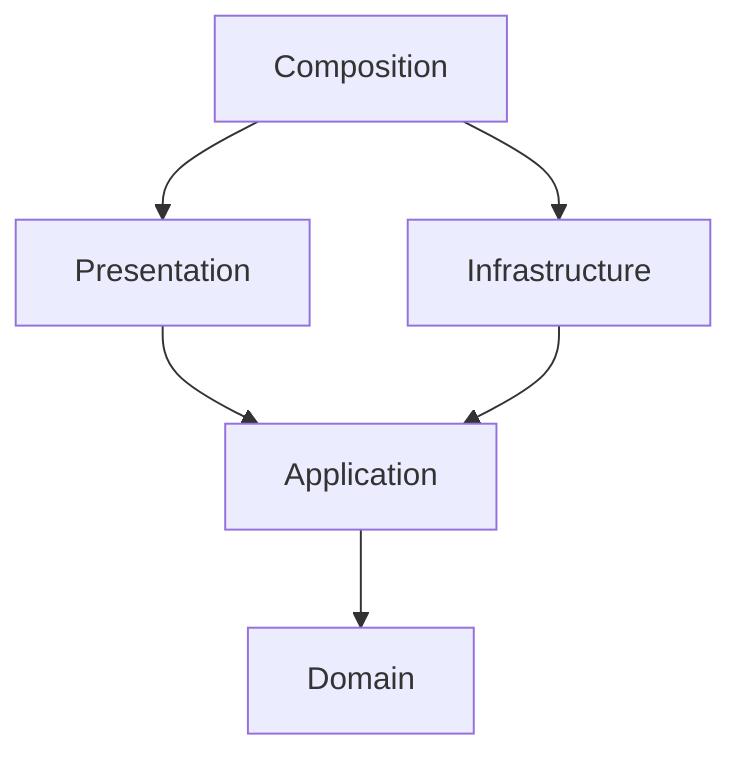

# Trading Session context

Harbor Market is a single-player resource trading game: buy grain and salt,
carry limited cargo across six market days and maximize settled coins.
M2 implements this contract as a pure domain (`src/harbor_market/domain/model.py`).

| Term | Meaning and planned model |
| --- | --- |
| Coins | Non-negative integer value object; no real money or fractional units. |
| Good | Value object identifying grain or salt; each unit occupies one cargo slot. |
| Cargo | Immutable value object mapping goods to non-negative quantities, capacity eight. |
| Quote | Positive integer buy/sell price per unit of one good on one day. |
| TradingSession | Aggregate/entity with identity, day, coins, cargo and active/settled state. |
| TradeExecuted | Immutable event recording side, good, quantity, price and resulting balance. |
| DayAdvanced | Immutable event recording the new day and its quotes. |
| SessionSettled | Immutable event recording final coins after remaining cargo is sold. |
| CargoValuation | Pure domain service calculating cargo value from the current quotes. |

A session starts on day one with 20 coins and empty cargo. Day quotes are fixed
domain data, identical for every new session (the table is below).
Buy and sell share the same quote that day. Several trades per day are allowed.
Advancing from day six liquidates cargo at day-six quotes and settles the session.
Settled sessions reject further actions. Invalid actions leave all state unchanged.
Quantities must be positive integers; purchases cannot overspend or exceed capacity;
sales cannot exceed held cargo. There is no debt, market stock limit or trading fee.

Example at a quote of three coins: buying four grain changes 20 coins/empty cargo
to eight coins/four grain. Selling two at four coins later gives 16 coins/two grain.
Settlement at five coins then gives 26 coins/empty cargo. These are illustrative
quotes, not the six-day price table. Buying nine units always exceeds capacity.

## The six market days

| Day | Grain | Salt |
| --- | --- | --- |
| 1 | 3 | 5 |
| 2 | 4 | 4 |
| 3 | 2 | 6 |
| 4 | 5 | 3 |
| 5 | 3 | 7 |
| 6 | 6 | 5 |

Prices are coins per unit. A session that never trades settles at 20 coins; the
largest possible result is 118, found by dynamic programming in the tests and
reached by one plan played through the aggregate.

The **Trading Session** bounded context owns quotes, holdings, trades and settlement.
Authentication, real finance, multiplayer auctions, shipping simulation and external
price feeds are excluded. This differs from deduction puzzles and delivery routing:
the central decision is when to exchange coins for cargo under a capacity limit.

## Dependency direction

Domain uses the standard library. Application owns use cases and repository ports;
infrastructure implements those ports with Django ORM records and SQLite migrations.
Presentation handles Django forms, views and templates; composition alone wires
concrete adapters. ORM models are persistence records, not domain aggregates.
Import Linter enforces layer direction, independent adapters and exclusion of
Django and sqlite3 from both core packages. A subprocess imports the core with
site packages disabled. Dynamic imports are prohibited in core code.

## Roadmap and sources

1. M1: vocabulary, empty core packages, health route and verification.
2. M2 (done): values, aggregate, events, valuation and pure rule tests.
3. M3: start/trade/advance/read use cases, ORM repository and restart/atomicity tests.
4. M4: one browser screen, complete six-day run, restart and actual screenshot.

WASM, database models, migrations and playable screens are deferred.
Architecture is a project design choice; Django does not mandate this DDD layout.
Official references checked 2026-11-06:

- [Django settings](https://docs.djangoproject.com/en/6.1/topics/settings/)
- [Django testing tools](https://docs.djangoproject.com/en/6.1/topics/testing/tools/)
- [Import Linter contracts](https://import-linter.readthedocs.io/en/stable/contract_types/)
