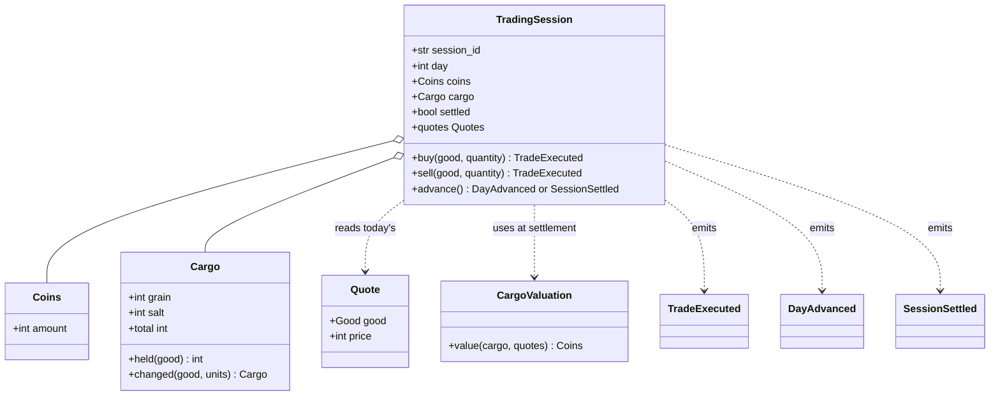
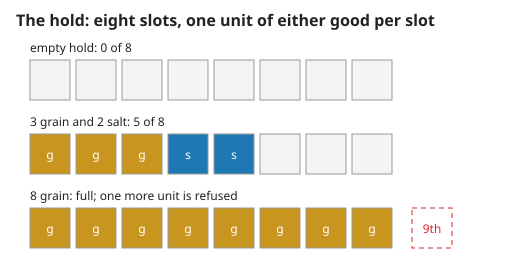
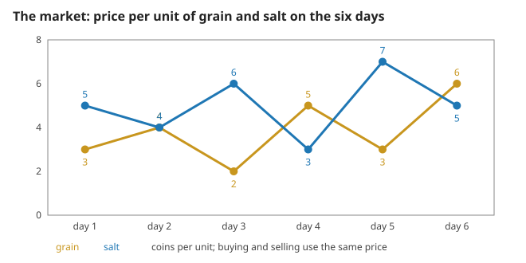
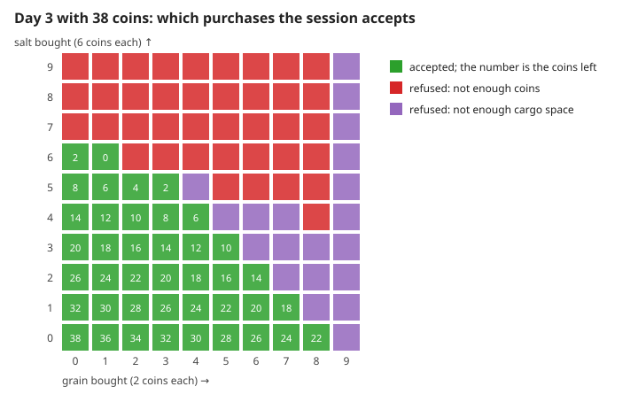
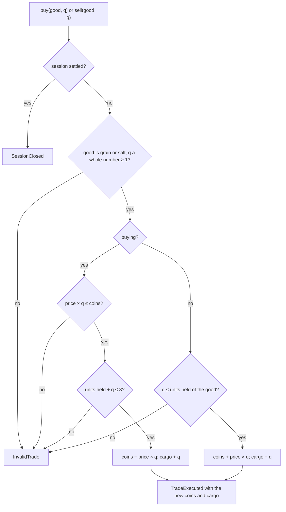

# 1. Coins, cargo, quotes and one trade

A single-player trading game: twenty coins, a hold of eight, two goods, six days of fixed prices. No real money is involved. Measured numbers are quoted by their id in [figures/values.md](figures/values.md).

[Back to the index](README.md)

## S01 — The language of the game

**Statement.** Eleven terms, each with one meaning:

| Term | Meaning |
|---|---|
| Coins | a non-negative whole number; the only currency |
| Good | grain or salt |
| Cargo | units held of each good; every unit fills one of eight slots |
| Quote | the price per unit of one good on one day, the same for buying and selling |
| Market | the six days of quotes, identical for every session |
| Trading session | one game: an identity, the day, coins, cargo, and whether it is settled |
| Trade | buying or selling a whole number of units of one good at today's quote |
| TradeExecuted | the record of a trade: side, good, quantity, price, resulting coins and cargo |
| DayAdvanced | the record that the next day began, with its quotes |
| SessionSettled | the record that day six ended: the remaining cargo was sold, the final coins |
| Cargo valuation | the rule that says what a cargo is worth at given quotes |

**Assumptions and where they break.** One player, no clock, nothing random, no other traders: prices do not react to trades.

**Derivation.** Definitions; the code uses the same words as class names.

**Code.** `src/harbor_market/domain/model.py`: `Coins`, `Good`, `Side`, `Cargo`, `Quote`, the mapping type `Quotes`, the table `MARKET` with `DAYS`, the constants `STARTING_COINS` and `CAPACITY`, `CargoValuation`, `TradingSession`, the events `TradeExecuted`, `DayAdvanced`, `SessionSettled` and their union `Event`, the exceptions `InvalidTrade` and `SessionClosed`.

**Tests.** `test_REQ_TRADE_exact_balances_of_the_documented_shape` in `tests/test_domain.py` builds these objects and compares the events by value.

## S02 — Whole coins, and a hold of eight

**Statement.** Coins are a whole number $c \ge 0$. A cargo holds whole numbers $g \ge 0$ of grain and $s \ge 0$ of salt with

$$g + s \le 8 .$$

A price is a whole number $p \ge 1$. A value outside these bounds cannot be constructed, so a session can never hold a debt, a fraction of a unit, or a ninth unit. Values are immutable: changing a cargo makes a new cargo.

**Assumptions and where they break.** Truth values and whole-valued fractions such as 1.0 are refused, not converted.

**Derivation.** A design rule; checking in the constructor means every later rule may assume the bounds.

**Code.** `Coins.__post_init__`, `Cargo.__post_init__`, `Cargo.total`, `Cargo.changed` and `Quote.__post_init__` in `src/harbor_market/domain/model.py`; the capacity is `CAPACITY`.

**Tests.** `test_REQ_VALUE_coins_and_quotes_are_whole_and_bounded`, `test_REQ_VALUE_cargo_is_immutable_and_holds_eight`. Measured: `coins-rejected` = 4 of 4, `cargo-rejected` = 4 of 4, `quote-rejected` = 3 of 3, `cargo-capacity` = 8.

## S03 — The market is a fixed table

**Statement.** There are six days. On day $d$ grain costs $p_g(d)$ and salt $p_s(d)$ coins per unit:

| Day $d$ | 1 | 2 | 3 | 4 | 5 | 6 |
|---|---|---|---|---|---|---|
| grain $p_g$ | 3 | 4 | 2 | 5 | 3 | 6 |
| salt $p_s$ | 5 | 4 | 6 | 3 | 7 | 5 |

Buying and selling use the same price; there is no fee and no limit on how much the market will trade. The worth of a cargo at day $d$ is

$$V_d(g, s) = g \, p_g(d) + s \, p_s(d) .$$

**Assumptions and where they break.** The table is part of the rules, the same for every session; it is not a model of a real market. Because the buy and sell prices are equal, trading back and forth within a day costs nothing (S05).

**Derivation.** Data, chosen so that each good rises on some nights and falls on others.

**Code.** `MARKET`, `DAYS`, `Quote`, `Quotes` and `CargoValuation.value` in `src/harbor_market/domain/model.py`; a session reads its day's row through `TradingSession.quotes`.

**Tests.** `test_REQ_VALUE_market_table_and_valuation` (the table is written out again by hand in the test). Measured: `market-days` = 6, `market-low` = 2, `market-high` = 7, `market-valuation` = 19 coins for three grain and two salt on day 1, `market-same-table` = 1.

## S04 — One trade: exact, or refused with nothing changed

**Statement.** With $c$ coins, cargo $(g, s)$ and today's price $p$ of the chosen good, a trade of $q$ units is accepted exactly when $q$ is a whole number $\ge 1$ and

- **buying**: $p\,q \le c$ and $g + s + q \le 8$; then $c \to c - p\,q$ and the good's holding grows by $q$;
- **selling**: $q \le$ the units held of that good; then $c \to c + p\,q$ and the holding shrinks by $q$.

Every check happens before the first change, so a refused trade leaves the day, the coins and the cargo exactly as they were. Several trades a day are allowed. When both limits fail, the session reports the coins first.

**Assumptions and where they break.** No partial fills: asking for more than is affordable buys nothing, not "as much as possible".

**Derivation.** The two inequalities are the bounds of S02 applied to the result; the set of acceptable purchases is therefore the lattice points of a polygon cut by a budget line and a capacity line, as the figure shows for one state.

**Code.** `TradingSession.buy`, `TradingSession.sell` and the shared check `TradingSession._check` in `src/harbor_market/domain/model.py`; the exception `InvalidTrade`; the sides `Side`.

**Tests.** `test_REQ_TRADE_exact_balances_of_the_documented_shape`, `test_REQ_TRADE_several_trades_a_day_and_both_goods`, `test_REQ_TRADE_quantities_are_positive_whole_numbers`, `test_REQ_TRADE_no_overspending_no_overloading_no_short_selling`. Measured: `trade-buy-coins` = 8 and `trade-buy-cargo` = 4 after buying four grain at 3; `trade-sell-coins` = 16 after selling two at 4; `trade-event` = 1; `trade-refused` = 5 of 5 with `trade-refused-unchanged` = 1. On the grid of the figure `feasible-accepted` = 41 of 100, equal to the count of lattice points with $2g + 6s \le 38$ and $g + s \le 8$; `feasible-refused` = 59, of which the session names coins for `feasible-coins` = 39 and cargo space for `feasible-space` = 20.

## References

- E. Evans, *Domain-Driven Design*, Addison-Wesley, 2003, ch. 5 — value objects, entities and services.
