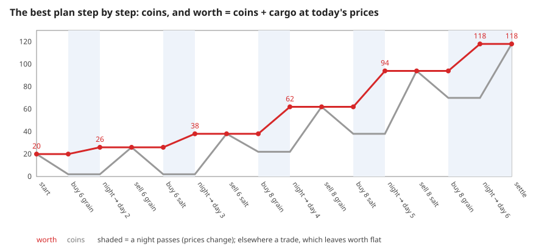
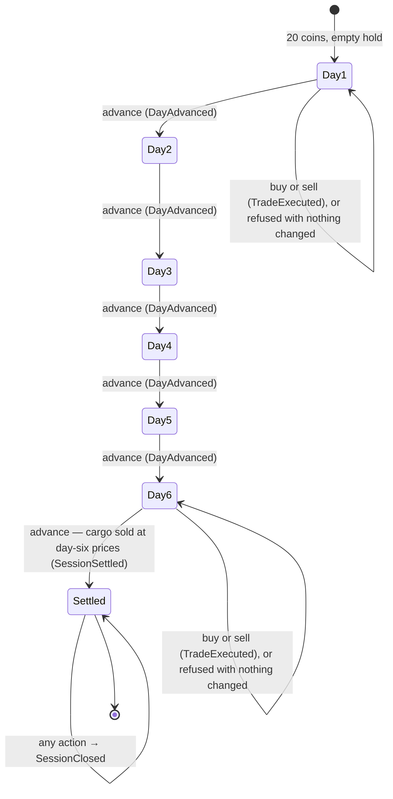
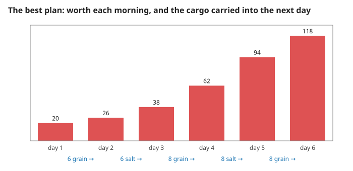
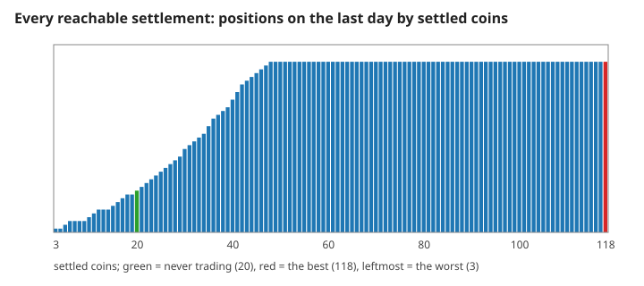
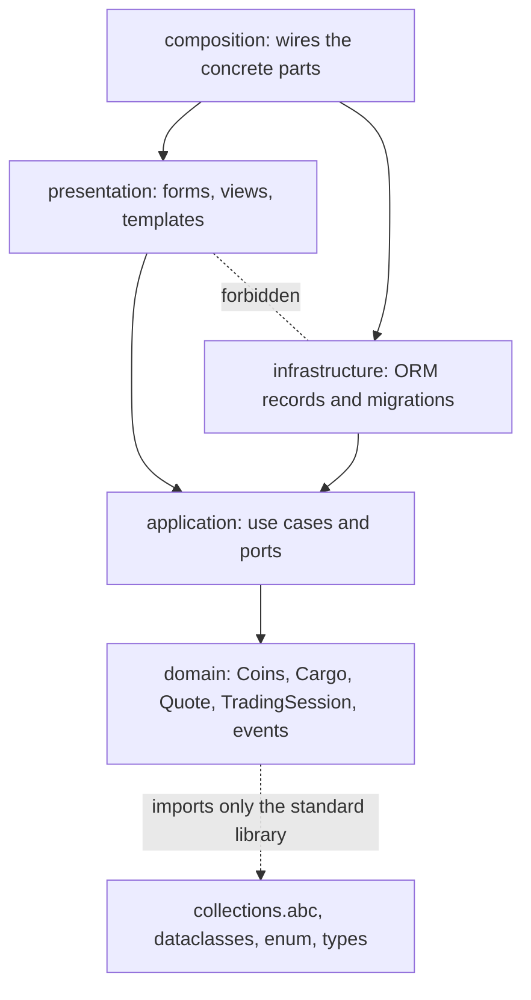

# 2. Worth, the six days, the best plan, and where the rules live

Why a trade never changes what a session is worth, how the days end in settlement, why 118 coins is the most that can be had, and why the rules do not depend on the web framework. Measured numbers are quoted by their id in [figures/values.md](figures/values.md).

[Back to the index](README.md)

## S05 — A trade conserves worth; only a night changes it

**Statement.** Define the worth of a session on day $d$ as its coins plus its cargo at today's prices (S03):

$$W = c + g\,p_g(d) + s\,p_s(d) .$$

Every accepted trade leaves $W$ unchanged. When the day advances from $d$ to $d+1$ with cargo $(g, s)$ on board,

$$W \;\to\; W + g\,\bigl(p_g(d+1) - p_g(d)\bigr) + s\,\bigl(p_s(d+1) - p_s(d)\bigr) .$$

So coins are won or lost only by what is in the hold overnight.

**Assumptions and where they break.** This needs buying and selling at the same price and no fee (S03). With a spread or a fee each trade would lower $W$.

**Derivation.** Buying $q$ units at price $p$ changes the coins by $-p\,q$ and the cargo's value by $+p\,q$ (S04); selling does the reverse. The sum is unchanged. Overnight the coins and the cargo stay and only the prices in the formula change.

**Code.** `TradingSession.buy` and `TradingSession.sell` (the two changes are equal and opposite), `TradingSession.advance` (the day changes, nothing else) and `CargoValuation.value` in `src/harbor_market/domain/model.py`.

**Tests.** `test_REQ_TRADE_exact_balances_of_the_documented_shape`, `test_REQ_DAY_best_plan_reaches_the_computed_optimum_through_the_domain`. Measured over the best plan played through the aggregate: `worth-trade-drift` = 0 coins across its 9 trades, `worth-night-gain` = 98 coins over its nights and settlement, `worth-events` = 15, `worth-final` = 118.

## S06 — Six days, then settlement

**Statement.** A session starts on day 1 with 20 coins and an empty hold. `advance` moves from day $d$ to $d + 1$ for $d \le 5$. Advancing from day 6 **settles**: the remaining cargo is sold at day-six prices,

$$c_\text{final} = c + g\,p_g(6) + s\,p_s(6) = W ,$$

the hold is emptied, and the session accepts no further action — not a trade, not another advance. A session that never trades settles at its starting 20 coins.

**Assumptions and where they break.** There is no way back to an earlier day and no way to skip one.

**Derivation.** A design rule. By S05 settlement is itself worth-conserving: it turns the worth on day 6 into coins.

(Days 2 to 5 accept trades in the same way as days 1 and 6.)

**Code.** `TradingSession.advance`, `TradingSession.__post_init__` (the day lies between one and six), the constants `STARTING_COINS` and `DAYS`, the events `DayAdvanced` and `SessionSettled`, the exception `SessionClosed` in `src/harbor_market/domain/model.py`.

**Tests.** `test_REQ_DAY_six_days_then_settlement`, `test_REQ_DAY_final_liquidation_uses_day_six_quotes`, `test_REQ_DAY_settled_sessions_reject_every_action`, `test_REQ_DAY_session_creation_is_validated`, `test_REQ_DAY_same_actions_give_the_same_session`. Measured: `days-sequence` = 6, `idle-settles` = 20, `settle-liquidation` = 31 coins from 4 coins, two grain and three salt, `settle-empties` = 0, `settled-refuses` = 3 of 3, `replay-identical` = 1.

## S07 — The best plan reaches 118 coins

**Statement.** The largest possible settlement is **118 coins**. It is reached by carrying, each night, the cargo with the largest overnight gain that the day's worth can pay for:

| Night | Carried | Gain per unit | What limits it | Worth next morning |
|---|---|---|---|---|
| 1 → 2 | 6 grain | +1 | coins: 6 × 3 = 18 of 20 | 26 |
| 2 → 3 | 6 salt | +2 | coins: 6 × 4 = 24 of 26 | 38 |
| 3 → 4 | 8 grain | +3 | the hold | 62 |
| 4 → 5 | 8 salt | +4 | the hold | 94 |
| 5 → 6 | 8 grain | +3 | the hold | 118 |

**Assumptions and where they break.** The argument uses S05; with a fee or a spread, selling everything each morning would no longer be free and the nightly rule could fail.

**Derivation.** By S05 a session can sell its whole cargo in the morning at no loss, so everything that matters on a morning is the single number $W$. Let $B_d(W)$ be the best settlement from worth $W$ on day $d$: $B_6(W) = W$ and

$$B_d(W) = \max_{\substack{g + s \le 8 \\ g\,p_g(d) + s\,p_s(d) \le W}} B_{d+1}\Bigl(W + g\,\Delta_g(d) + s\,\Delta_s(d)\Bigr), \qquad \Delta(d) = p(d+1) - p(d) .$$

A larger $W$ allows every cargo a smaller one allows, so $B_d$ never decreases in $W$ (induction from day 6 backwards). Hence the best choice each night is the one that makes the next morning's worth largest — the nightly rule — and the recursion is the dynamic programming of [Bellman 1957]. Each night's choice is a small two-constraint knapsack; here one good falls or stays level every night, so only the rising good is carried.

**Code.** There is no solver in the game: `TradingSession` only applies the rules. The numbers come from playing through `TradingSession.buy`, `TradingSession.sell` and `TradingSession.advance`.

**Tests.** `test_REQ_DAY_best_plan_reaches_the_computed_optimum_through_the_domain` computes $B_1(20) = 118$ by the recursion, written independently of the domain, and plays one plan that reaches it. Measured by a second, exhaustive method — every state reachable by one-unit trades, explored through the aggregate: `search-states` = 10011, `search-best` = 118, `search-worst` = 3, `search-distinct` = 116 different settlements; the nightly rule gives `greedy-final` = 118 and `greedy-matches-search` = 1.

## S08 — The rules do not know about the web

**Statement.** The code is in four layers, and imports point inward only:

$$\text{composition} \;\to\; \{\text{presentation},\ \text{infrastructure}\} \;\to\; \text{application} \;\to\; \text{domain} .$$

Presentation and infrastructure do not import each other. The domain and the application import neither Django nor sqlite3; the domain uses the standard library only.

**Assumptions and where they break.** The rule is about import statements; the second test below, which imports the core with third-party packages unavailable, also catches an import of Django hidden inside a function.

**Derivation.** If the rules import nothing from the outer layers, they can be run, tested and reasoned about without a server or a database — every figure in this handbook was drawn that way — and the framework or the storage can change without touching them [Evans 2003, ch. 4; Martin 2017, ch. 22].

**Code.** The two Import Linter contracts in `pyproject.toml` (`Adapters point inward and remain independent`, `Core excludes Django and direct database access`); `src/harbor_market/domain/__init__.py` exports the eighteen names of S01.

**Tests.** `make check` runs Import Linter (2 contracts kept); `test_REQ_CORE_imports_without_frameworks` in `tests/test_scaffold.py` imports the domain and the application in a fresh interpreter without the frameworks.

## References

- R. Bellman, *Dynamic Programming*, Princeton University Press, 1957 — the principle of optimality.
- E. Evans, *Domain-Driven Design*, Addison-Wesley, 2003.
- R. C. Martin, *Clean Architecture*, Prentice Hall, 2017.
