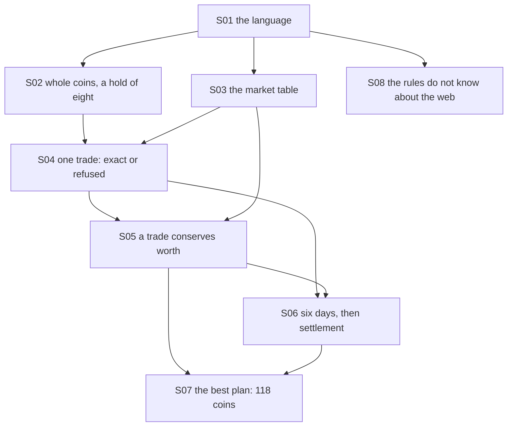

# Theory handbook

Why the program is correct, from the repository alone: every rule and invariant the code relies on, each stated in Markdown **with a figure**, the place in the code that implements it, and the test or measurement that checks it.

- Drawn figures and the numbers quoted in the text are produced by the domain itself: `make theory-figs` rewrites [figures/](figures/) and [figures/values.md](figures/values.md) (under a second). Other diagrams are Mermaid, written in the pages.
- `make theory-check` fails when a statement has no figure, a link is broken, a referenced function, test or measured value no longer exists, or a name exported by the domain is missing from the table below.

## Pages

1. [Coins, cargo, quotes and one trade](01-values-and-trades.md) — the language, whole and bounded values, the market table, what one trade does
2. [Worth, the six days, the best plan, and where the rules live](02-days-and-the-best-plan.md) — conservation of worth, settlement, why 118 is the most, the dependency rule

## How the pieces depend on each other

## Coverage: statement → page → figure → code → test

| ID | Statement | Page | Figure | Code | Test |
|---|---|---|---|---|---|
| S01 | The language of the game | [1](01-values-and-trades.md) | mermaid | `src/harbor_market/domain/model.py#Good`, `src/harbor_market/domain/model.py#Side`, `src/harbor_market/domain/model.py#Event`, `src/harbor_market/domain/model.py#TradeExecuted` | `tests/test_domain.py#test_REQ_TRADE_exact_balances_of_the_documented_shape` |
| S02 | Whole coins, whole units, a hold of eight | [1](01-values-and-trades.md) | `figures/hold.svg` | `src/harbor_market/domain/model.py#Coins`, `src/harbor_market/domain/model.py#Cargo`, `src/harbor_market/domain/model.py#CAPACITY` | `tests/test_domain.py#test_REQ_VALUE_coins_and_quotes_are_whole_and_bounded`, `tests/test_domain.py#test_REQ_VALUE_cargo_is_immutable_and_holds_eight` |
| S03 | The market is a fixed six-day table; one price for both sides | [1](01-values-and-trades.md) | `figures/prices.svg` | `src/harbor_market/domain/model.py#MARKET`, `src/harbor_market/domain/model.py#Quote`, `src/harbor_market/domain/model.py#Quotes`, `src/harbor_market/domain/model.py#CargoValuation` | `tests/test_domain.py#test_REQ_VALUE_market_table_and_valuation` |
| S04 | One trade is exact, or refused with nothing changed | [1](01-values-and-trades.md) | `figures/feasible.svg`, mermaid | `src/harbor_market/domain/model.py#def buy`, `src/harbor_market/domain/model.py#def sell`, `src/harbor_market/domain/model.py#InvalidTrade` | `tests/test_domain.py#test_REQ_TRADE_no_overspending_no_overloading_no_short_selling`, `scripts/theory_figs.py#feasible-accepted` |
| S05 | A trade conserves worth; only a night changes it | [2](02-days-and-the-best-plan.md) | `figures/worth.svg` | `src/harbor_market/domain/model.py#def value`, `src/harbor_market/domain/model.py#TradingSession` | `scripts/theory_figs.py#worth-trade-drift`, `tests/test_domain.py#test_REQ_TRADE_several_trades_a_day_and_both_goods` |
| S06 | Six days, then settlement at day-six prices | [2](02-days-and-the-best-plan.md) | mermaid | `src/harbor_market/domain/model.py#def advance`, `src/harbor_market/domain/model.py#DAYS`, `src/harbor_market/domain/model.py#STARTING_COINS`, `src/harbor_market/domain/model.py#DayAdvanced`, `src/harbor_market/domain/model.py#SessionSettled`, `src/harbor_market/domain/model.py#SessionClosed` | `tests/test_domain.py#test_REQ_DAY_six_days_then_settlement`, `tests/test_domain.py#test_REQ_DAY_settled_sessions_reject_every_action` |
| S07 | The best plan reaches 118 coins | [2](02-days-and-the-best-plan.md) | `figures/plan.svg`, `figures/outcomes.svg` | `src/harbor_market/domain/model.py#def quotes` | `tests/test_domain.py#test_REQ_DAY_best_plan_reaches_the_computed_optimum_through_the_domain`, `scripts/theory_figs.py#search-best` |
| S08 | Layers and the inward dependency rule | [2](02-days-and-the-best-plan.md) | mermaid | `pyproject.toml#Adapters point inward and remain independent`, `src/harbor_market/application/ports.py`, `src/harbor_market/infrastructure/repository.py`, `src/harbor_market/composition/use_cases.py` | `tests/test_scaffold.py#test_REQ_CORE_imports_without_frameworks`, `tests/test_persistence.py#test_REQ_PERSISTENCE_session_and_events_survive_connection_reopen` |

Tests named `scripts/theory_figs.py#…` are measurements recorded in [figures/values.md](figures/values.md) by `make theory-figs`, not assertions of `make check`.

## Reading the source against this table

Reviewed for this handbook: all of `src/harbor_market/domain/model.py` (the eighteen names exported by `src/harbor_market/domain/__init__.py`), the two Import Linter contracts in `pyproject.toml`, the application port, ORM repository and composition wiring, and the domain, application and persistence tests. Presentation remains health-only; playable routes are M4.

The program is unchanged by this handbook: it adds `scripts/theory_figs.py`, `scripts/theory_check.py`, two Makefile targets, one Ruff per-file setting and these pages.
